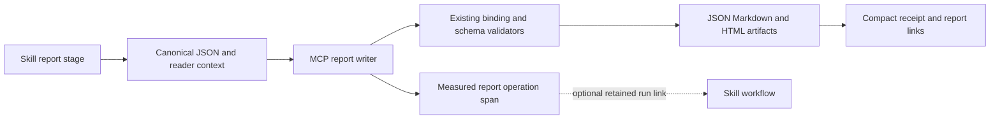
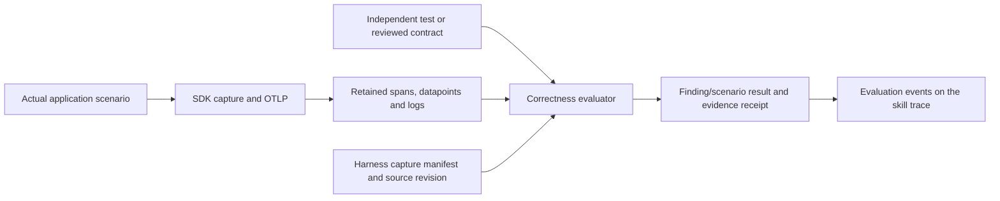

# Observable skill workflows

## Objective

Observe normal audit, instrumentation, and verification workflows without an
eval-only telemetry dependency. Preserve their existing prompts, report schemas,
scope/approval rules, producer choices, and optional offline operation.

## Plan

1. Capture clean-main rubric results before changing skills. Preserve the original
   rubric criteria and compare them separately from new observability criteria.
2. Add SEP-2640 discovery and resource delivery over MCP, with complete digests,
   bounded content, origin-scoped URIs, and compatibility with existing tools.
   Preserve local discovery and public skill commands; clean up long entry points
   into mandatory stage references and serve a self-contained remote projection.
3. Define a small stage/branch vocabulary for the three existing public skills.
   Add a standard-library recorder with an explicit run identifier, an atomic
   local journal, measured executable stages, and separately labeled checkpoints.
   Recording or export failure must not prevent the original skill operation.
4. Ingest completed stage spans through MCP and expose them through existing
   Studio traces/metrics plus a workflow query with missing-stage diagnostics.
   Resource-delivery measurements remain distinct from skill execution.
5. Add trajectory checks to the eval harness: required stages, forbidden branches,
   ordering constraints, evidence, and incomplete/failed-path handling. Test
   realistic fixtures with short skill prompts and independent result assertions.
6. Run focused tests, all affected deterministic suites, candidate rubric runs,
   and live HTTP/stdio evidence. Compare original baseline criteria, fix observed
   regressions, and document exact results and limitations before handoff.

## Measurement contract

- A server resource-read span measures local request handling, never activation,
  execution, or confirmed client receipt. Cached reuse need not produce another
  server request.
- A stage executed by the recorder has measured command duration and exit status.
  A model-reported checkpoint is labeled as such and is not equivalent proof.
- A workflow's elapsed time is bounded by explicit start/finish calls. Missing
  finish remains incomplete, not successful. No timing is inferred from file age.
- Explicit run IDs keep concurrent/repeated runs separate. Stable stage IDs,
  branch IDs, attempts, and parent edges make the observed path inspectable.
- No model token counts are invented. Native provider attribution is a separate
  optional source; absent tokens remain unknown.
- Journals contain bounded metadata, not prompts, command arguments, environment
  values, command output, credentials, or application source.
- The local journal survives source-process exit. Studio's telemetry remains
  bounded in memory and can be repopulated explicitly from the journal.
- Instrumentation verification judges application behavior. Workflow diagnostics
  compare recorded steps with a declared contract; they identify improvement
  candidates, not automatic proof that skill prose caused a failure.

## MCP-owned report publication

The audit, instrumentation and verification report stages prefer
`observer_audit_report_write`, `observer_instrumentation_report_write` and
`observer_verification_report_write`. The agent supplies the canonical report
object, an absolute repository directory on the server filesystem, and structured
reader context. The server owns validation, canonical JSON publication, Markdown
projection, HTML rendering and the restricted loopback report server. Existing
schemas and the required final response remain intact. Findings, source inspection,
application changes, tests and independent correctness checks remain separate work.



Each invocation automatically records an `execute_tool` operation in scope
`obstudio.report-writer`, including errors. A supplied retained `runId` links the
operation to the matching skill workflow. Without one, the operation still has
its own server-generated trace. It establishes report publication, not the start,
duration or completion of the entire skill. A client can still omit publication;
only workflows whose authoritative output passes through these tools have this
server-observed reporting boundary. No provider OTel configuration is required
for these server measurements, and no provider tokens are inferred.

The implementation reuses the bundled Python normalizers and HTML renderer,
adding deterministic Markdown generation rather than maintaining a second schema
implementation in Go. A compatible Python runtime is therefore required on the
server. Existing local report commands and the same standalone writer remain
available when MCP or the server filesystem is unavailable. Invalid or stale
evidence is an input error, not a reason to bypass validation through the fallback.
Direct baseline instrumentation without a canonical audit keeps its existing path.

Unchanged requests reuse artifact receipts; every MCP invocation is still a
separate measured operation. Downstream writes preserve audit HTML and selection.
The writer validates and renders before changing canonical files, serializes
cooperating writers, checks input identities and rejects symlink output paths.
Each file replacement is atomic; the complete multi-file publication is not a
filesystem transaction. Interrupted publication reports a failure and requires
inspection before retrying. Artifacts persist on disk; operation spans use the
existing bounded in-memory retention.

This should reduce model-authored report formatting and duplicate prose. Existing
HTML was already deterministic, so its byte size is not a token saving. Structured
evidence and required final-response content still consume tokens; tool discovery
also has overhead. No controlled before/after token reduction has been measured.

## Compatibility and acceptance

SEP-2640 is Final (merged September 13, 2026). The implementation targets the
published Skills extension for base protocol revision `2026-07-28`, rather than
the historical proposal's earlier wire shapes. Specification status does not
establish client support. Keep the adapter independent of the recorder and
verify each host/version before claiming native skill loading.

Sources: [published extension](https://modelcontextprotocol.io/extensions/skills/overview),
[Final proposal](https://github.com/modelcontextprotocol/modelcontextprotocol/pull/2640),
[versioned protocol](https://modelcontextprotocol.io/specification/2026-07-28/basic/index).

Keep local filesystem skills, all existing MCP tools, HTTP and stdio consumers,
and normal execution when Studio is unavailable. Advertise the Skills extension
only when its catalog is available. Negotiate the per-request protocol metadata
for modern clients and retain the older initialization handshake for existing
clients. A malformed skill must not suppress unrelated catalog entries/tools.

No provider configuration is modified. These server/helper signals do not need
Codex or Claude native OTel enabled. Client support for SEP-2640 and model token
telemetry must be verified independently for each host/version.

## GenAI telemetry and evaluations

The skill workflow is a real coordinated operation, so its completed root uses
`invoke_workflow <skill>` with `gen_ai.operation.name=invoke_workflow` and
`gen_ai.workflow.name`. Recorder-executed commands use `execute_tool` children,
a stable `<skill>.<stage>` tool name, call identity, actual command interval,
exit code, and error status/type. Checkpoints remain ordinary instantaneous
spans; reporting a checkpoint does not establish a tool or model invocation.
The original stage sequence, branch, attempt, evidence count and observation
source remain visible in the waterfall and workflow query.

This follows the operation hierarchy in
[Galileo's integration recommendations](https://docs.galileo.ai/sdk-api/third-party-integrations/opentelemetry-and-openinference/integration-recommendations)
and [Splunk Agent Observability's recommendations](https://agent-observability-docs.splunk.com/sdk-api/third-party-integrations/opentelemetry-and-openinference/integration-recommendations).
The recorder deliberately captures metadata only: arguments, prompts, outputs,
provider/model identity and model usage are unavailable. This does not establish
full vendor ingestion compliance: those destinations may require content and
routing fields. No vendor SDK, credentials, cloud export, or provider telemetry
configuration is installed by this feature. Studio displays absent token usage
as unknown, preserving the distinction from an explicit measured zero.

Every completed workflow is evaluated against retained telemetry for declared
stage coverage, predecessor order, latest stage outcomes, and nonzero command
exits (including recovered attempts). `observer_skill_workflow_evaluate` also
accepts 1–32 declarative named rules. For example, pass these tool arguments:

```json
{
  "runId": "<actual 32-character run ID>",
  "rules": [
    {"name": "audit.go_path", "check": "stage_branch", "stage": "discover", "expected": "go"},
    {"name": "audit.report_budget", "check": "stage_duration", "stage": "report", "maxMs": 1500},
    {"name": "audit.workflow_budget", "check": "workflow_duration", "maxMs": 300000}
  ]
}
```

Other checks are `stage_present`, `stage_outcome`, `workflow_outcome`,
`stage_coverage`, `stage_order`, `stage_outcomes`, and `command_success`.
Definitions and the observed telemetry are hashed into an immutable evaluation
receipt. Repeating the same evaluation does not duplicate it. Determinate
results become `gen_ai.evaluation.result` events on a separate child span;
Studio's existing evaluation badges roll them up to the workflow. Evaluation
spans are omitted from execution metrics and model-call accounting. Their
instant timestamp references workflow completion and does not claim measured
evaluator latency.

Unfinished workflows, evicted observations, absent commands, and checkpoint
latency checks return unknown without a numeric score or a passing event.
Checks describe the recorder's observations, including self-reported stages;
they cannot prove task correctness, complete host activity, or why skill prose
caused a failure. Content-based correctness still needs report/code evidence
and rubric grading. This mirrors Galileo's distinction between
[code-based metrics and model-based evaluation](https://docs.galileo.ai/concepts/metrics/overview).
The workflow query returns both path diagnostics and evaluation events for
subsequent dataset selection and regression analysis.

## Evaluate application correctness contracts

`observer_skill_correctness_evaluate` adds a separate evaluation path for
per-finding application telemetry. It consumes explicit expectations linked to
audit finding/scenario IDs, report digests, source revision and an application
capture witness. The complete wire and harness contract lives in the
[verification reference](../skills/otel-verify/references/correctness-evaluations.md),
which is also served in the SEP catalog and packaged with the local skill.
`otel-verify` reads it when a project/user supplies an optional contract.



Span checks cover exact count, required attributes, kind, status and parentage.
Metric checks cover exact datapoint count, type, unit, required dimensions and
optional gauge/sum value ranges; logs cover event category, severity, required
attributes and app-span correlation. A complete declared capture can establish
that a required signal was missing. A matching contract passes an
`instrumentation` claim and refutes an `audit_gap` claim; a mismatch reverses
those results. Missing, stale, evicted or contract-only captures remain unknown.
These are scenario contracts rather than an automatic judgment of all code or
all audit findings. Original workflow checks remain independent and unchanged.

The checker inspects actual retained data instead of accepting a skill's
reported success. The caller still owns the expectations, report bindings and
harness. Manifests establish consistency with the retained capture, not
cryptographic attestation of application execution or completeness upstream of
the SDK. A producer could lie; an expectation author could choose a weak
contract. Report digests are recorded bindings, not local file validation.
Independent app tests and reviewed/seeded expectations are therefore required
before describing the result as independent correctness evidence. Precision or
recall across all audit gaps, model judgment, source scanning, performance
regression statistics and cloud receipt are not implemented by this tool.
