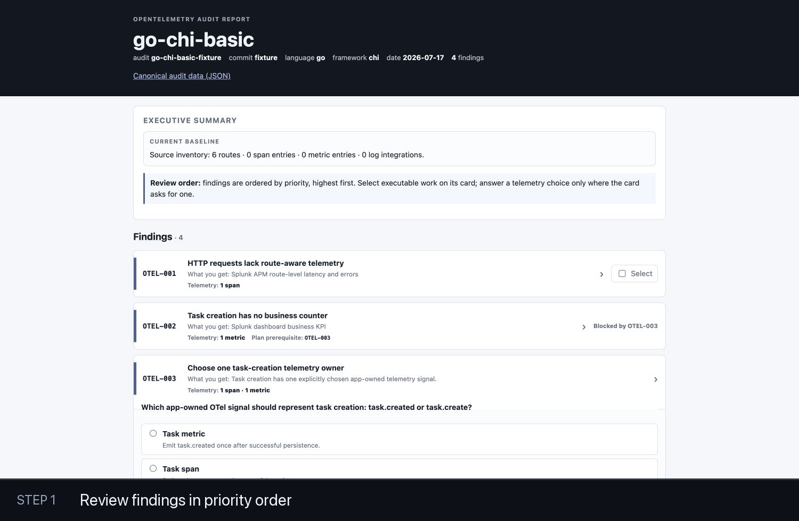
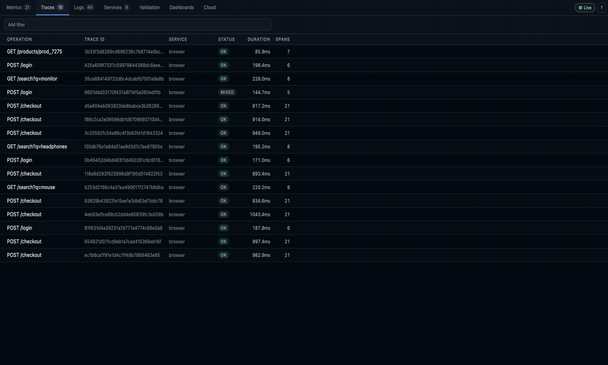
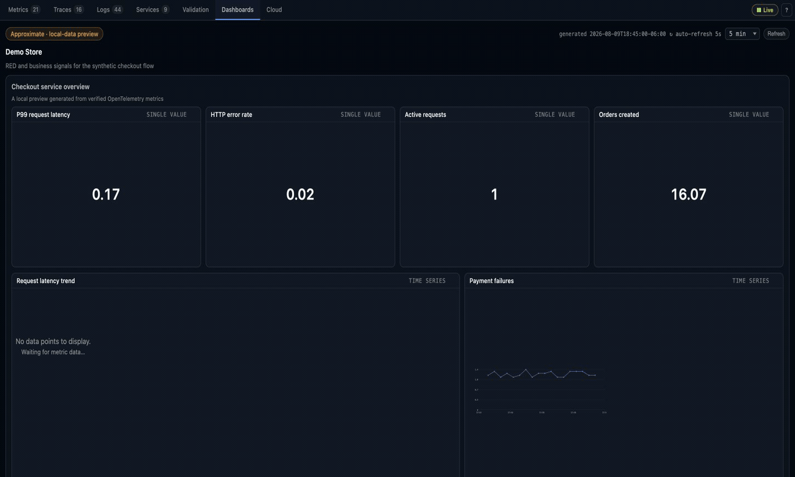
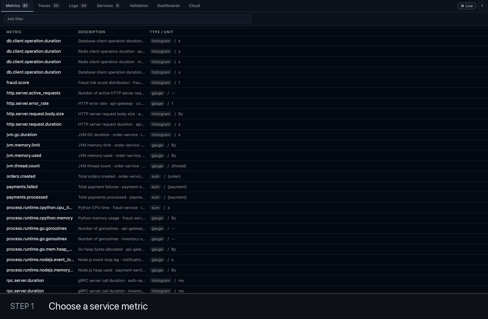
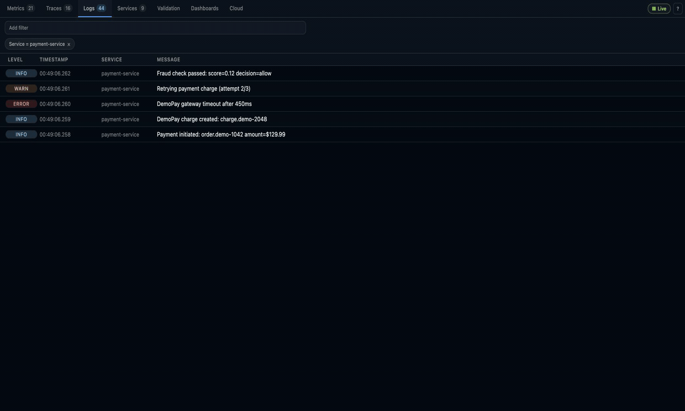
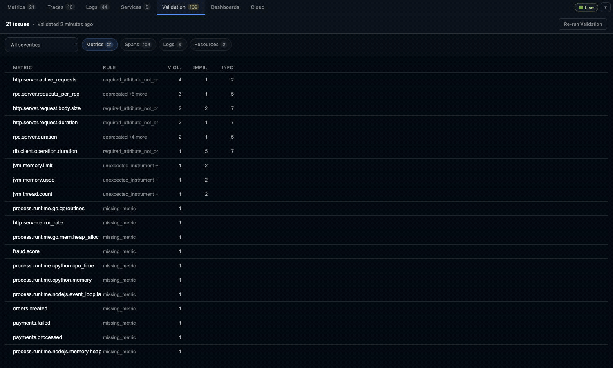

# Splunk Observability Studio

Give your coding agent an evidence-backed OpenTelemetry workflow, then inspect
the proof without leaving your editor. The extension bundles agent skills and a
local Splunk Observability Studio runtime for traces, metrics, logs, services,
validation, dashboard previews, and optional Splunk Observability Cloud export.

## Install

| Editor | Install from |
|---|---|
| Cursor | [Open VSX](https://open-vsx.org/extension/splunk/observability-studio) |
| Kiro | [Open VSX](https://open-vsx.org/extension/splunk/observability-studio) |
| Visual Studio Code 1.82+ | [Visual Studio Marketplace](https://marketplace.visualstudio.com/items?itemName=Splunk.observability-studio) |
| Windsurf / Devin Desktop | [Open VSX](https://open-vsx.org/extension/splunk/observability-studio) |

After installing:

1. Run **Splunk Observability Studio: Open**.
2. For Cursor, Kiro, Claude Code, or Codex, accept the detected integration
   prompt or run the matching enable command from the Command Palette.
3. After enabling an integration, fully restart the agent and start a new task
   so it reloads its skills and local MCP connection.

The extension provides these integration commands:

| Agent | Command Palette action |
|---|---|
| Cursor | **Enable Cursor Integration** |
| Kiro | **Enable Kiro Integration** |
| Claude Code | **Enable Claude Code Integration** |
| Codex | **Enable Codex Integration** |

### GitHub Copilot in VS Code

With **VS Code 1.109 or newer** and GitHub Copilot agent chat, the extension
contributes all nine bundled skills automatically. Start a new chat and type
`/otel-audit`, `/otel-instrument`, or `/otel-verify`; Copilot can also select
relevant skills from their descriptions. No skill-copy command or changes to
your workspace or personal Copilot settings are required. Older editors retain
the existing runtime and integration features but do not discover these native
skill contributions.

Skills and MCP tools are separate. For workflows that use the local runtime's
MCP tools, run **Splunk Observability Studio: Open**, then use **MCP: Add Server**
in VS Code to add an HTTP server at `http://127.0.0.1:17900/mcp` named `obstudio`.
Use the configured `managedObserverPort` or `sharedObserverUrl` instead when
overridden. Keep the runtime running and approve the MCP server when prompted.
Native extension skills apply to VS Code chat, not the standalone Copilot CLI.

VS Code also synchronizes contributed skills to agent-plugin caches for hosted
agent sessions. Each contributed entrypoint therefore carries a complete
runtime skill bundle under `bundle/` and directs the agent to the unchanged
canonical workflow inside it. Shared report helpers, sibling verification
skills, and references remain available even when only one skill directory is
copied. The CLI-managed Codex and other integrations retain their existing layout.

For Windsurf and Devin Desktop setup, follow the standalone CLI
instructions in the
[user guide](https://github.com/signalfx/obstudio/blob/main/docs/USER.md#agent-targets).

## Run your first audit

From the service root, enter the audit command in your coding-agent chat:

| Agent | Command form |
|---|---|
| Codex | `$otel-audit` |
| Copilot in VS Code, Claude Code, Cursor, Kiro, or Devin Local | `/otel-audit` |
| Legacy Cascade | `@otel-audit` |

Open the returned report and follow the next step it recommends. The
[user guide](https://github.com/signalfx/obstudio/blob/main/docs/USER.md#using-the-skills)
explains the complete audit, instrumentation, verification, and publishing
workflow.

## Inspect the proof

Run **Splunk Observability Studio: Open** to inspect the evidence inside your
editor. See the [Splunk Observability Studio guide](https://github.com/signalfx/obstudio/blob/main/observer/README.md)
for runtime behavior, endpoints, views, and API details.

**Trace a request.** Open a trace to inspect its waterfall and slow
dependencies.

**Preview a dashboard.** Generate a dashboard with your agent, then compare the
layout with local telemetry. The preview is approximate because SignalFlow
runs in Splunk Observability Cloud.

**Inspect metrics and logs.** Filter retained metric series and structured logs
without leaving the editor.

**Validate semantic conventions.** Run the bundled OpenTelemetry Weaver
validator and inspect actionable findings by signal and severity.

## Commands and configuration

| Command Palette action | Purpose |
|---|---|
| **Splunk Observability Studio: Open** | Open the local panel. |
| **Splunk Observability Studio: Status** | Inspect the runtime, logs, and recovery actions. |
| **Splunk Observability Studio: Start** | Start the extension-owned process. |
| **Splunk Observability Studio: Stop** | Stop the extension-owned process. |
| **Splunk Observability Studio: Restart** | Restart the extension-owned process or reconnect another local instance. |

The extension-managed Splunk Observability Studio uses the fixed port `17900`
for its UI, REST API, and MCP HTTP endpoint, with OTLP receivers fixed at
`4318` and `4317`. The port is not a VS Code setting: `obstudio` is
editor-agnostic, so a per-editor setting could not stay in sync with CLI or
other-editor launches. If `17900` is taken, free it (or attach to the existing
instance via `sharedObserverUrl`) rather than moving obstudio — the bundled
skills all pin `17900`. Only as a last-resort break-glass option, and knowing it
breaks those skills, can you run on a different port by setting `OBSTUDIO_PORT`
in `~/.obstudio/env` or passing `--port` to the binary.

Extension settings use the `observability-studio.` prefix:

- `sharedObserverUrl` reuses another Splunk Observability Studio instance
  running on this machine. Use `localhost` or `127.0.0.1` in the URL. It must
  report the same version bundled with the extension; send telemetry to that
  instance's own receiver endpoints.

## Data and permissions

An extension-managed Splunk Observability Studio instance keeps received
telemetry local unless you enable Cloud export. A separately managed local
instance follows its own configuration. Cloud export sends traces and metrics,
not logs, and the extension stores its access token in IDE secret storage.

For the bundled Codex and Claude Code plugin, see its
[security](https://github.com/signalfx/obstudio/blob/main/plugins/obstudio/SECURITY.md)
and [privacy](https://github.com/signalfx/obstudio/blob/main/plugins/obstudio/PRIVACY.md)
contracts.

## Troubleshooting

- If Splunk Observability Studio cannot start, check the fixed UI/MCP port
  `17900` and the fixed OTLP ports `4318` and `4317`. If a foreign process holds
  `17900`, free it — or reuse the running instance via `sharedObserverUrl`. The
  bundled skills pin `17900`, so moving obstudio (`OBSTUDIO_PORT` in
  `~/.obstudio/env` or `--port`) is a last-resort break-glass action that breaks
  those skills.
- If `sharedObserverUrl` does not connect, confirm that the configured local
  Splunk Observability Studio is reachable and its version matches the extension.
- After enabling an integration, fully restart the agent and start a new task.
  Existing processes keep their startup settings.
- If Copilot does not offer `/otel-audit`, confirm VS Code is 1.109 or newer,
  reload the window after installing the updated VSIX, and start a new agent
  chat. Use **Chat: Configure Skills** to inspect skill discovery. MCP server
  setup alone does not install skills.
- If a session reports a missing shared report helper from an `agentPlugins`
  cache, install the updated VSIX, reload the window, and start a new session so
  VS Code refreshes its synchronized skills. Do not copy helpers into an
  application repository or manually patch generated agent caches.
- Dashboard previews use the first workspace folder captured when Splunk
  Observability Studio starts. Open the service in its own window or make it
  the first folder, then run **Splunk Observability Studio: Restart** after
  switching repositories.
- Use **Splunk Observability Studio: Status** to restart, reconnect, or open
  extension logs.

## Resources

No separate collector, web runtime, or Weaver installation is required for
normal extension use.

- [User guide](https://github.com/signalfx/obstudio/blob/main/docs/USER.md)
- [Splunk Observability Studio guide](https://github.com/signalfx/obstudio/blob/main/observer/README.md)
- [Example prompts](https://github.com/signalfx/obstudio/blob/main/docs/examples.md)
- [Source and releases](https://github.com/signalfx/obstudio)
- [Contributing](https://github.com/signalfx/obstudio/blob/main/CONTRIBUTING.md)
